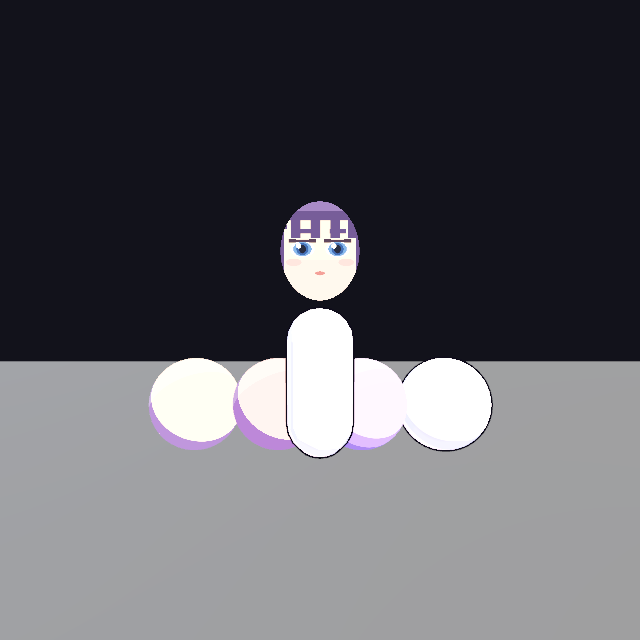

# BlenderGameKit

**在 Blender 里做完游戏,只在测试时打开 Godot。**

**一个 `.blend` 文件对应一个 Godot 项目。** 打开哪个 Blender 工程,就知道该往哪导出,
不用每次填路径。

| 你想做的事 | 在 Blender 里 | 在 Godot 里 |
|---|---|---|
| 摆场景、建模型 | ✅ | |
| 做动作、材质、卡通调参 | ✅(EEVEE 预览) | |
| 写游戏逻辑 | ✅(中文节点图) | |
| **测试与游玩** | | ✅ |

**在 Blender 里摆好的场景会原样出现在 Godot 里** —— 点『导出模型和材质』
会把整个场景(含层级、位置、灯光、相机、碰撞体)一起导出。

**这就是回答"能不能在 Blender 里做设计"的答案:能。** 3D 角色、地面、
道具、相机、灯光都在 Blender 里摆,导出的 `.tscn` 里就是这些节点:

```
Body        [CharacterBody3D]      ← 挂着节点图生成的脚本
  Collision [CollisionShape3D]     ← 碰撞体从 Blender 的物理面板自动生成
Environment [Node]                 ← 相机 / 灯光 / 卡通材质
World       [instance glb]         ← 网格 + 层级 + 变换
```

实测:相机 1 个、灯光 1 个、碰撞体 3 个全部带过去,Godot 里跑 90 帧无报错。

> **2D 小人不一样。** 2D 精灵图是图片,Blender 不做像素画。
> 想全程在 Blender 里做,建议直接走 **3D 平面**路线:角色做成薄片网格 +
> NPR 卡通材质 + 正交相机 —— 视觉上就是 2D,但全部在 Blender 里可控。
> 你的目标是二次元 **3D** 游戏,那本来就不需要 2D 精灵这条路。

**别忘了勾『脚本挂载目标』。** 在物体的『游戏物理 (BlenderGameKit)』面板里,
一般选角色身体那一个。不勾的话导出的场景里**不会有脚本**,角色不会动
(导出过程不会报错,只是会给你一条告警提示)。

喜欢你熟悉的 Blender 交互，也喜欢 UE5 的蓝图；这个插件就是为这个组合做的：

| 你的痛点 | BlenderGameKit 的做法 |
|---|---|
| UPBGE 逻辑砖太简陋、没汉化 | 89 个中文节点，含分支 / 序列 / 循环 / 等待 / 信号 / 状态机 / 相机 / 存档 / 音效 / 界面 |
| Godot 界面简陋、不熟悉、没有可视化脚本 | 逻辑在**你熟悉的 Blender 节点编辑器**里画，Godot 只负责运行 |
| UE5 太臃肿、配置要求高 | 生成的是纯 GDScript，Godot 本体只有几十 MB |
| Unity 国内版不好用 | 完全不依赖 Unity |
| 导出路径每次都要填 | **跟着 `.blend` 走**,一个文件一个项目,自动建好目录结构 |
| 碰撞体要跑到 Godot 里配 | **在物体属性面板里设**(像 UPBGE),导出时自动生成 |
| **按键在 Godot 里要手工加输入映射** | **自动写进 `project.godot`** —— 节点图用了哪些动作就登记哪些,并绑好默认键(A/D/W/S、空格、J、E) |
| 二次元游戏 | **3 个 NPR 卡通着色器**(描边/边缘光/三阶明暗/面部 SDF) + 手绘线条抖动 |

不是运行时解释器，是**代码生成器**：节点图 → 标准 GDScript 4 → 随便改、随便读、Godot 原生调试。
渲染也不是"通用 PBR 降级版"，而是按日式动画赛璐璐的做法写的。

---

## 一分钟上手

1. **保存 `.blend`**(Ctrl+S)—— 项目要建在它旁边,所以必须先有路径
2. 打开节点编辑器 → 新建 **游戏逻辑** 节点树
3. 编辑器顶部会出现 **创建 Godot 项目**,点它 → 建好后问你要不要用 Godot 打开
4. **点『生成示例节点图』** —— 直接给一条能跑的链路,照着改就行
5. 开始画逻辑:按 **Shift+A** 添加节点(和 Blender 其他地方一样)
6. 侧栏 **导出为 Godot 脚本** / **导出模型到 Godot**
7. 想测试时点 **打开 Godot 编辑器**(或 **直接运行游戏**)

> **节点怎么用?** 一句话:**金色线是骨架**。必须先放一个『事件』节点当入口
> (比如「每当_准备」),再用金色『执行』线把后面要做的事串起来。灰色线只是传值。
> 详细教程见 [docs/Blender与Godot互通.md](docs/Blender与Godot互通.md) 第五节。

项目结构自动长这样:

```
我的游戏/
├── 我的游戏.blend          ← 你的 Blender 工程
└── 我的游戏_godot/         ← 配套的 Godot 项目(自动创建)
    ├── project.godot       主场景已自动指好,按 F5 就能跑
    ├── scripts/            逻辑脚本(节点图生成)
    ├── scenes/             场景装配(模型 + 脚本 + 碰撞体)
    ├── art/                模型 .glb 与贴图 .png
    ├── materials/          卡通材质 .tres
    └── shaders/            NPR 着色器
```

**为什么不做成 `.blend` 同目录下?** 那样 `.godot/` 导入缓存和 `.blend1` 备份文件
会混在一起,Godot 还会去扫描 `.blend1` 这类垃圾文件。固定用同名子目录最干净。

**想放到别处?** 侧栏『项目』→ **改位置**。这个选择会**写进 `.blend`**,下次打开还记得。

---

## 四条最重要的文档

| 你想知道 | 看这个 |
|---|---|
| **节点怎么连、三条必经规则、从零到能跑角色的顺序** | [docs/节点怎么连.md](docs/节点怎么连.md) |
| **项目怎么组织、模型贴图怎么进 Godot、脚本怎么挂、C++ 怎么写** | [docs/Blender与Godot互通.md](docs/Blender与Godot互通.md) |
| **卡通着色怎么调、参数什么意思** | [docs/渲染-NPR卡通着色.md](docs/渲染-NPR卡通着色.md) |
| 安装、上手、节点清单、踩过的坑 | 就是本文件 |

---

## 目录结构

```
pyproject.toml                  pytest 配置与开发依赖(离线测试入口)
BlenderGameKit/                 插件本体(这个文件夹就是要安装的东西)
├── __init__.py                 注册入口(按依赖顺序注册所有类)
├── blender_manifest.toml       Blender 扩展清单
├── gk_sockets.py               引脚类型:执行流 / 任意值 + 内置类型语义表
├── gk_log.py                   日志(面板里能看最近 200 条)
├── models.py                   共享数据模型:ExportSettings / CodegenResult / Diagnostic
├── paths.py                    路径工具(纯标准库):res:// 归一化、目录穿越防护
├── blender_adapter.py          Blender 适配层:集中 bpy 访问(.blend 路径 / 当前场景)
├── exporter.py                 脚本落盘、Godot 工程骨架(事务式导出,失败整体回滚)
├── codegen/                    ★ 节点图 → GDScript 代码生成器(按领域拆分)
│   ├── literals.py             字面量 / 类型名 / 常量工具
│   ├── registry.py             装饰器 + 注册表 + 派发(expr / stmt / multi_output)
│   ├── expressions.py          非动画表达式发射器(数学 / 逻辑 / 输入 / 骨骼……)
│   ├── statements.py           非动画语句发射器(运动 / 属性 / 射线 / 流程控制……)
│   ├── animation.py            动画播放 / 状态机 / 动画树 / 动画变量
│   ├── camera.py               相机套件(切换 / 机位 / 弹簧臂 / 路径 / 跟随)
│   ├── services.py             音频 / 存档 / 屏幕 UI 与滤镜
│   ├── context.py              CodegenAbort / _Statements / GenContext
│   ├── generator.py            Generator 主体(扫描 → 组装)
│   ├── validation.py           导出前静态校验与告警
│   └── api.py                  对外入口(generate / generate_result / required_base_class)
├── asset_export.py             ★ 资产导出:glTF + 卡通材质 + 场景装配
├── npr_preview.py              ★ Blender 端 NPR 预览材质(EEVEE 里调卡通参数)
├── project/                    ★ 一个 .blend 一个 Godot 项目
│   ├── layout.py               路径解析 / 建骨架(art、scripts、scenes…)
│   ├── godot.py                引擎定位与进程管理
│   ├── input_map.py            把用到的输入动作写进 project.godot
│   ├── scene.py                主场景读写
│   └── metadata.py             生成标记(.gk_generated)
├── properties.py               场景级导出设置(2D/3D、基类、类名…)
├── operator_io.py              算子:导出脚本 / 导出模型 / NPR 预览 / 素材导出
├── ui.py                       侧栏面板、添加节点菜单、节点引用选择器
├── shaders/                    ★ NPR 着色器(随插件打包)
│   ├── gk_toon.gdshader        3D 卡通:色阶切分 / 三段明暗 / light_map / 面部 SDF
│   ├── gk_outline.gdshader     描边:反面外扩 + 手绘线条抖动(boiling line)
│   └── gk_toon_2d.gdshader     2D 精灵:伪造光照 / 边缘高光 / 受击闪白
└── nodes/
    ├── node_base.py            节点基类、声明式属性、桩环境支持
    ├── nodes.py                门面:合并下面各领域模块的命名空间
    └── _events.py / _flow.py / _movement.py / _animation.py /
        _instances.py / _variables.py / _input.py / _expressions.py /
        _display.py / _containers.py       ★ 128 个节点按领域拆分

docs/
├── Blender与Godot互通.md       资产管线 + 脚本搭载 + C++ GDExtension
└── 渲染-NPR卡通着色.md          着色器用法、参数含义、光照强度甜点区

tests/
├── gk_stub.py                  离线 bpy 打桩(让 codegen 脱离 Blender 可测)
├── test_codegen.py             321 个回归测试,秒级跑完,不需要 Blender
├── blender_smoke.py            63 项冒烟测试,在真实 Blender 里跑(含菜单结构、按键捕获与插件偏好设置注册/读取)
├── blender_anim_tree.py        ★ 动画/输入/相机/骨骼(真 Blender 建图导出,59 项)
├── bad_script_fixture.gd       故意写错的 GDScript,验证检查器真的能抓错
├── blender_asset_export.py     20 项资产导出测试(真的导出 .glb 并检查)
├── blender_npr_preview.py      23 项 NPR 预览测试(含 A/B 渲染对比)
├── blender_face_preview.py     面部 SDF 预览测试(五个角度对比左右脸亮度)
├── blender_project.py          ★ 项目绑定测试(51 项,含导出落点与启动参数自检)
├── blender_scene_export.py     ★ 整场景导出测试(验证层级与 Z-up→Y-up 变换)
├── blender_starter_graph.py    ★ 示例节点图测试(验证生成的 GDScript 可用)
├── blender_persistence.py      ★ 持久化测试(关掉再打开状态还在吗)
├── blender_menu.py             Shift+A / 右键菜单挂载测试
├── check_icons.py              校验节点图标名是否合法
└── bad_shader_fixture.gdshader 故意写错的着色器,用来验证校验台真的能抓错

scripts/
├── install.ps1                 构建 + 安装到 Blender
├── build_and_test.ps1          一键门禁:构建 + 重装 + 63 项冒烟 + Godot 端到端(2D 示例 + 平台跳跃;-Deep 再加动画六层)
├── verify_anim_system.ps1      ★ 动画系统六层验证(离线/真 Blender/示例/Godot 解析/**真跑 1.5 秒**/反例)
├── check_gdscript.ps1          ★ 把生成的 .gd 交给真 Godot 解析(带反例)
├── make_anim_example.py        ★ 生成动画状态机示例 .blend
├── check_anim_example.py       ★ 示例工程自查(22 项,含按键→Godot 映射)
├── make_anim_runtime_probe.py  ★ 把生成的脚本包成最小 Godot 工程真跑(解析过≠跑得起来;含弹簧臂不穿墙)
├── godot_verify.ps1            ★ 用 Godot 真实编译并运行 2D 示例(导入→真跑→行为断言);-OutDir 可输出到隔离目录
├── verify_shaders.py           ★ 在真实 Godot 里编译着色器,把错误带出来
├── render_shots.ps1            扫光出图(验证面部阴影 SDF 必需)
├── verify_jitter.ps1           ★ 手绘描边动画 A/B 验证(抓帧做像素差分)
├── make_face_preview_shots.py  出面部 SDF 预览的对比图(左/中/右三个角度)
├── make_project_demo.py        ★ 演示:一个 .blend 如何产出完整的 Godot 项目
├── analyze_face_sweep.py       扫光出图的量化粗筛(判据不可靠,只做参考)
├── make_face_sdf.py            生成面部阴影贴图模板(含一张示例脸)
├── make_demo.py                生成 2D 游戏示例工程
└── make_render_demo.py         生成 NPR 渲染示例工程(并可出图)

examples/
├── demo_anim_tree/             ★ 动画状态机示例 .blend(可照抄,见它的 README)
├── demo_platformer/            ★ 可玩的 2D 平台跳跃示例(相机跟随/金币/HUD/存档)
├── demo_2d/                    可直接用 Godot 打开的 2D 横版示例
├── demo_render/                NPR 渲染示例(含渲染结果 preview.png)
└── gdextension_cpp/            C++ GDExtension 骨架(GKCharacter)
```

---

## 安装

### 方式一:一键脚本(推荐)

```powershell
powershell -ExecutionPolicy Bypass -File scripts\install.ps1
```

如果 Blender 不在默认路径，指定一下：

```powershell
powershell -ExecutionPolicy Bypass -File scripts\install.ps1 -Blender "C:\Program Files\Blender Foundation\Blender 4.5\blender.exe"
```

### 方式二:在 Blender 界面里装

1. `编辑 > 偏好设置 > 获取扩展 > 右上角下拉 > 从磁盘安装`
2. 选择 `_dist\blender_game_kit-0.1.0.zip`
3. 启用它

> 需要 Blender **4.2 或更高**。开发和验证都在 **Blender 4.5.5 LTS** 上完成。
> 纯 Python 插件，不需要编译，不需要额外依赖。

---

## 五分钟上手

1. 打开 Blender，把某个区域的编辑器切成 **节点编辑器**
2. 编辑器头部把类型切成 **游戏逻辑**(如果没有就点"新建")
3. 按 **N** 打开侧栏 → 看到 **游戏逻辑(BlenderGameKit)** 面板
4. 点 **添加节点** → 从 **事件** 分类里加一个 **每当_物理帧**
5. 再加一个 **移动_按方向**(分类 **移动**)，把前者的 `执行` 连到后者的 `执行`
6. 加一个 **输入_方向向量**(分类 **输入**)，把它输出连到 `移动_按方向` 的 `方向`
7. 侧栏设置里选 **2D**，基类选 **CharacterBody2D**，填好导出目录
8. 点 **导出为 Godot 脚本**

生成的脚本长这样(真实输出，未删改)：

```gdscript
class_name PlayerController
extends CharacterBody2D

# ---- 输入动作名(Godot 输入映射里的动作)----
const ACTION_MOVE_LEFT := "move_left"
const ACTION_MOVE_RIGHT := "move_right"
const ACTION_JUMP := "jump"

# ---- 场景节点引用 ----
@onready var anim_player: AnimationPlayer = $AnimationPlayer

# ---- 可在检查器里调的参数 ----
@export var move_speed: float = 240.0  # 移动_按方向 · 速度
@export var jump_force: float = 520.0  # 移动_跳跃 · 强度

# ---- 成员变量 ----
var health: float

func _ready() -> void:
    health = 3.0

func _physics_process(delta: float) -> void:
    var _dir1 := (Input.get_vector(ACTION_MOVE_LEFT, ACTION_MOVE_RIGHT, ACTION_MOVE_UP, ACTION_MOVE_DOWN, 0.2)).normalized()
    self.velocity = _dir1 * move_speed
    self.move_and_slide()
    if self.velocity.x < 0.0:
        self.scale.x = -abs(self.scale.x)
    else:
        self.scale.x = abs(self.scale.x)
    if (self.is_on_floor() and Input.is_action_just_pressed(ACTION_JUMP)):
        self.velocity.y = -jump_force
```

几个设计细节：

- **手感参数自动变成 `@export`** —— 速度、跳跃力度这类"没连线的数值"会生成成检查器参数，可以在 Godot 里直接拖着调，不用改代码。连线了的值不会被暴露(图算出来的值不该被外部改)。
- **输入动作抽成常量** —— 所有按键名集中在脚本开头，改键一眼可见，也不会和 Godot 内置的 `ui_*` 动作混淆。
- **`@onready` 自动推断类型** —— `$AnimationPlayer` 会声明成 `AnimationPlayer` 而不是 `Node`，否则调用 `has_animation()` 会被 GDScript 静态类型拒绝。
- **`_unused_delta`** —— 没用到的 `delta` 会自动加一行占位，避免 Godot 警告刷屏。

---

## 节点一览(128 个)

| 分类 | 节点 |
|---|---|
| **事件** | 每当_准备、每当_每帧、每当_物理帧、每当_输入、自定义函数、调用_函数 |
| **流程** | 如果_否则、只执行一次、序列、循环_次数、等待_秒、打印_输出 |
| **移动** | 移动_设置速度、移动_滑动、移动_按方向、移动_跳跃、移动_施加冲量、移动_设置朝向、移动_水平翻转 |
| **动画** | ▸ **播放**:动画_播放、动画_状态机、动画_运行状态、动画_是否在播、动画_播放完成、动画_暂停/继续、动画_停止、动画_设播放速度、动画_时长、动画_切换状态、动画_设混合参数<br>▸ **骨骼**:骨骼_取数据、骨骼_设置、骨骼_跟随视角 |
| **动画系统**<br>(在「游戏动画」图里) | 动画_开始、动画_结束、动画_状态、动画_转场、动画判断_移动状态、动画_取变量、动画_设变量 |
| **实例** | 实例_生成、实例_销毁、实例_重载场景、取值_获取节点、取值_是否在地面 |
| **变量** | 变量_设置、变量_读取 |
| **信号** | 信号_发出、信号_连接 |
| **输入** | ▸ **键盘**:输入_方向、输入_按键<br>▸ **鼠标**:鼠标_按键按住、鼠标_按键按下、鼠标_滚轮、鼠标_位置、鼠标_移动量、鼠标_模式<br>▸ **手柄**:手柄_摇杆轴、手柄_摇杆方向、手柄_按键按住、手柄_按键按下、手柄_震动<br>▸ **触屏**:触屏_按键按住、触屏_拖动方向(手柄 / 触屏也收进『输入』了 —— 照 UPBGE 的排布) |
| **运算** | 常量_数值、常量_文本、常量_布尔、常量_向量、数学_运算、逻辑_比较、逻辑_布尔运算、数学_随机整数、向量_合并、向量_拆分、向量_长度、向量_归一化、转换_类型 |
| **显示** | 显示_设置可见、显示_暂停节点 |
| **相机** | 相机_设置、相机_启用、相机_切换、相机_弹簧臂、相机_路径、相机_位置、相机_旋转、相机_缩放、相机_取状态、相机_震动、相机_跟随 |
| **音效** | 音效_播放、音效_音乐、音效_停止音乐 |
| **存档** | 存档_写入、存档_读取到变量、存档_保存、存档_载入、存档_是否存在、存档_删除 |
| **界面** | 界面_文本、界面_进度条、界面_按钮、界面_隐藏控件 |
| **屏幕效果** | 屏幕_闪白、屏幕_渐变遮罩、屏幕_滤镜 |
| **射线** | 射线_检测、射线_有东西吗 |
| **定时** | 定时_每隔几秒、定时_缓动数值、定时_缓动属性 |
| **时间轴** | ★ 就是『定时_缓动属性』—— 一条节点管一条轨道,几条串起来 = 整体联动 |
| **列表** | 列表_新建、列表_添加、列表_移除、列表_取第几个到变量 |
| **字典** | 字典_写入、字典_读取到变量、字典_有键吗 |
| **时间** | 时间_设置倍速 |
| **实用** | 注释框 |
| **动画(旧)** | 动画_状态表(旧)—— 隐藏的老节点,老图照旧能加载能导出 |

> 菜单是**两级**的:『运算』下面是 常量/数学/向量/逻辑/转换,『输入』下面是
> 键盘/鼠标/手柄/触屏(照 UPBGE 的排布)。被新版取代的老节点
> (『输入_按键按住(旧)』『动画_状态表(旧)』)不会出现在菜单里,但**不会失效**。

### 动画状态机(照虚幻 5 的 Animation Blueprint)

**先看示例**:`examples/demo_anim_tree/动画状态机示例.blend`
（6 个状态 / 一个状态 4 条出线 / 自定义布尔变量当条件 / 播完就切,全接好了;
生成脚本 `blender -b --python scripts\make_anim_example.py`,自查
`blender -b --python scripts\check_anim_example.py`)。

动作规则**不写在玩法图里**,而是另开一张『游戏动画』图,玩法图只留一个
『动画_状态机』节点驱动它 —— 这样两张图都不会糊成一团。

```
玩法图                              游戏动画图
┌──────────────┐                   ┌────────────────────────────┐
│ 每当_准备     │                   │ [动画_状态 idle] ● 转到 ──┐ │
│  动画_状态机 ─┼──驱动────────────>│                          ↓ │
└──────────────┘                   │ [动画_转场] ● 转到 ──> [动画_状态 run]
                                   └────────────────────────────┘
```

| **特性** | 说明 |
|---|---|
| **开始口 / 结束口** | 『动画_开始』指明从哪个状态开始(**不用再靠"谁没被指到"去猜**),开始条件可自定义(立刻 / 变量为真 / 刚按下 / 上一个动画播完 / 自己接条件引脚);『动画_结束』= 这段动画演完了,状态机收工 |
| **动画的布尔情况能读** | 『动画_运行状态』给出 `已结束` / `在跑` / `当前状态`,玩法图里直接 `如果(已结束) -> 接着做下一步` |
| **一个状态多条出线** | idle 可以同时接「→run」「→jump」「→attack」。判定顺序 = **画布上从上到下**,第一个成立的赢,一帧只走一步(和 UE5 一样) |
| **状态直连 = 播完就切** | 两个状态直接连线,不用放转场节点。等价于 Godot 的 auto-advance |
| **转场三件套** | 上游(从哪来)+ 条件(什么时候切)+ 转到(去哪)。**少一样导出时点名告警** |
| **忘了连线也不致命** | 转场上有『从』『到』下拉兜底(连线优先) |
| **入口数量可调** | 一个状态要被几条转场指着,就把『入口 [N]』调到几 —— Blender 一个输入引脚只允许一条线,满了新线会顶掉旧的(调数量时已有连线会保住) |
| **状态自己做事** | 每个状态有『进入时』『离开时』两个**执行流出口**(照 UE5 的 State Entry/Exit)—— 设变量、播音效都接这儿,『动画_设变量』因此真的会被执行 |
| **一个状态播多段动画** | 『同时播 2 / 3』两个槽:骨骼动作 + 形态键动作这类**必须同时播**的动画(Godot 的 `play()` 一次只播一段,所以自动开"层播放器") |
| **『动画_播放完成』是个节点** | 能和『逻辑_布尔运算』拼成"(某动画播完了) **并且** (在地面)"这种复合条件;玩法图里也能用来"播完就设变量" |
| **条件就地拼** | 常量/数学/向量/比较/布尔运算/输入/鼠标/手柄读取/动画查询**都能在动画图里用** —— 和蓝图一样,不用回玩法图算完再想办法递过来 |
| **自定义变量** | 侧栏声明 bool/float/…,用『动画_取变量』拉到『条件』引脚上;改它可以在状态的进入/离开时,也可以在玩法图里 |
| **起始状态真的会播** | 没有任何转场指向它的状态 = 起始状态(没放开始口时的老规矩),进游戏就 `play()` 它 |
| **"播完"用信号,不用 `current_animation`** | Godot 的 `current_animation` 在一次性动画播完时会变成**空串**(第 22 条),所以用 `animation_finished` 信号 |
| **诊断写在脸上** | 问题同时出现在三处:节点上、侧栏『游戏动画』面板、导出报告。缺线/重名/孤立/条件为空,一条不漏 |

### 输入:按一下键就绑好(照 UPBGE 的 Keyboard Key)

| 节点 | 说明 |
|---|---|
| **输入_按键** | **一个节点顶三个**:『触发方式』= 按住 / 刚按下 / 松开(UPBGE 的 `Tap`)。点节点上的**『按一下键』**按钮,按哪个键就绑哪个 —— 不用记"jump 绑空格、move_right 绑 D"这套约定 |
| **键盘 / 鼠标 / 手柄 / 触屏** | 右键菜单里『输入』分成四栏(照 UPBGE 的 输入 ▸ 键盘 / 鼠标 / 游戏手柄 / VR)。**鼠标节点是新补的**:按键按住·按下、滚轮、位置、移动量、鼠标模式(锁定/可见) |
| 按键怎么进 Godot | 捕获到的键会写进 `project.godot` 的输入映射(`physical_keycode`)。你在 Blender 里按 C,Godot 里 C 就真的能用 —— 导出报告里会写明绑了几个动作 |

> 『输入_按键按住(旧)』『输入_按键按下(旧)』被收进菜单末尾、**默认不显示**了,
> 但老图里已经在用的照旧能加载、能导出(和『动画_状态表(旧)』一个待遇)。

### 变量:一张卡片设多个(照蓝图 Set 节点)

```
[变量_设置]  数量 = 3
   1. is_attacking  ← [常量_布尔 假]      ← 每个『值』引脚可以接**不同**的节点
   2. combo_ready   ← [常量_布尔 真]
   3. score         ← [数学_运算 …]
   ● 完成 ──> [如果_否则] 条件 ← [动画_运行状态 已结束]
```

* 第 1 个变量的引脚仍叫『值』、属性仍是老名字 —— **老图接好的线不会断**
* 每个『值』引脚可接不同节点(一个输入引脚只能接一条线,所以要多个就调『数量』)
* 『完成』执行流可以**扇出**到多个判断节点
* 布尔变量不小心填了数字(数字框只能填数字)会转成 `true/false` 并提醒你接『常量_布尔』

### 时间轴 / 相机(把"场景动画"和"镜头语言"做出来)

| 节点 | 做什么 | 设计要点 |
|---|---|---|
| **定时_缓动属性** | 把**任意节点的任意属性**在时间里推过去 | `position:y` 开门、`modulate:a` 淡出、`light_energy` 变暗… 用的是 Godot 的 `Tween`,**异步**:调用完立刻返回,所以几条缓动天生**同时**跑 |
| **相机_切换** | 切相机;填了『过渡(秒)』就是**丝滑推镜** | 做法:让**新**相机先站到旧相机的位姿上再插值回自己 —— 两台相机都不用被挪走,来回切也不跑位。每帧推进挂在 `_physics_process`,和角色同一个时钟 |

### 摄像机套件(照虚幻的 Camera + SpringArm 做的)

用户第四轮的原话是"摄像机的设置,切换,启用与禁用,视距,视野……弹簧臂的设计,
摄像机的旋转,缩放,位置等向量,浮点……同样是按照虚幻蓝图进行"。对照关系:

| 虚幻里的东西 | 我们的节点 | 说明 |
|---|---|---|
| `CameraComponent.FieldOfView` | **相机_缩放** / **相机_设置** | 3D 改 `fov`、2D 改 `zoom`,自动按相机真实类型分派 |
| `Set View Target with Blend` | **相机_切换**(过渡秒数) | 丝滑推镜 |
| `Activate` / `Deactivate` | **相机_启用** | 禁用时**只有它正开着才摘**(否则会把别人的画面弄黑) |
| `SpringArm.TargetArmLength` | **相机_弹簧臂**·臂长 | 视距 |
| `SpringArm.SocketOffset` | **相机_弹簧臂**·高度/侧向偏移 | 越肩视角往右挪一点 |
| `SpringArm.bDoCollisionTest` | **相机_弹簧臂**·碰撞检测 + 碰撞半径 | **撞到墙就把杆子缩短 —— 镜头不穿墙** |
| `SpringArm.CameraLag` | **相机_弹簧臂**·位置/旋转平滑 | 指数平滑,**和帧率无关**(固定系数的 lerp 在 30 帧和 144 帧手感完全不同) |
| `SetActorLocation` / `SetActorRotation` | **相机_位置** / **相机_旋转** | 两种给法:**向量**引脚,或 X/Y/Z(偏航/俯仰/翻滚)**浮点**;『保留』= 相对加,『直接设』= 绝对 |
| `GetCameraComponent` | **相机_取状态** | 名字 / 位置 / 朝向 / 视野 / 开着吗 —— 给逻辑判断用 |
| 场景里多台相机分别设置 | 每台相机一个『相机_设置』/『相机_启用』,用『如果_否则』分支挑 | 这就是"分支的场景摄像机设置" |

> **弹簧臂是不穿墙的关键**:从角色头顶打一条射线到"想退到的位置",
> 撞到东西就把相机拉到撞点前面(`碰撞半径`留余量),再指数平滑过去。
> 实测(最小 Godot 工程真跑):杆子 5 米、身后 2 米一堵 1 米厚的墙,
> 相机停在 **1.20 米** = 墙面 1.5 − 半径 0.3 ✓

**动作属于哪个角色**也自动认:选『动画』时用的是原生动作选择器,
列表里属于当前模型的动作带 ★ 排在最前面(动作归属靠 Blender 4.4+ 的
slot 名字判断,不靠猜)。详细的连线图和排错表见
[节点怎么连](docs/节点怎么连.md) 第五节。

### 手柄 / 触屏 / 屏幕滤镜(87 节点版本新增)

| 节点 | 做什么 | 设计要点 |
|---|---|---|
| **手柄_摇杆轴** | 读某根轴 / 扳机 | **自带死区**。`Input.get_joy_axis` 不做死区,摇杆回中不准的手柄会一直输出 0.05 之类的值,角色就自己走路 |
| **手柄_摇杆方向** | 一根摇杆 → 方向向量 | 直接接到『移动_按方向』上 |
| **手柄_按键按住 / 按键按下** | 手柄按键 | Godot 没有手柄按键的 `just_pressed`,所以"刚按下"靠**记住上一帧**实现。做跳跃要用『按下』,用『按住』会连发 |
| **手柄_震动** | 受击 / 爆炸反馈 | 用场景树计时器**自动停**,不会一直震 |
| **触屏_按键按住** | 虚拟按键 | 和键盘共用同一套输入动作名,不用配两遍 |
| **触屏_拖动方向** | 虚拟摇杆 | 触摸拖动在 Godot 里是**事件**、没有"当前值",只能自己累积;所以生成器会补一个 `_input` 来收事件,并**每帧清零**(不清零的话手指不动角色也会一直走) |
| **屏幕_滤镜** | 受击变红 / 中毒变绿 / 回忆泛黄 | 全屏 `ShaderMaterial` + `SCREEN_TEXTURE` 读屏。层号 90:盖住界面(10)、低于闪白/转场(100)。支持过渡秒数(强度平滑变化,不突兀) |


### 射线 / 定时 / 列表 / 字典(79 节点版本新增)

| 节点 | 做什么 | 设计要点 |
|---|---|---|
| **射线_检测** | 打一条射线看打到什么 | **按项目维度生成两套代码**:2D 用 `get_world_2d()`、3D 用 `get_world_3d()`。写错在**编译期**就被 Godot 拒绝,所以不能用运行时判断。出口是**命中 / 没打中**两个 |
| **射线_有东西吗** | 视线判定 / 撞墙检测 | **纯表达式**,直接接到『如果_否则』的条件上。射线是"就地"射出去的(见下) |
| **定时_每隔几秒** | 刷怪 / 回血 / 自动存档 | `one_shot = false` 才是"每隔 N 秒";触发逻辑放在 `timeout` 回调里 |
| **定时_缓动数值** | 血条缓动 / UI 滑入 | 用 Godot 的 `Tween`,6 种速度曲线 × 3 种缓动方式 |
| **列表_新建/添加/移除/取** | 背包、刷怪表 | 取值**自带越界兜底**:`items[99]` 在 Godot 里会报错并中断当前帧 |
| **字典_写入/读取/有键吗** | 按名字存数据 | 读取时键不存在用『默认值』 |

两个值得记下的实现细节:

- **『射线_有东西吗』是纯表达式,但会"就地"生成好几行代码**。
  GDScript 的表达式在**被使用的作用域**里求值,所以这几行正好落在
  `if <条件>:` 之前,变量一定在使用前就绪。
  (踩过的坑:一开始把缩进写死成 0,代码被写进类体,
   Godot 报 `Unexpected identifier "_query13" in class body`。)
- **射线节点标记了 `gk_no_cache`**。生成器默认会缓存表达式文本;
  射线要是被缓存,第二次求值只会复用第一次的结果 —— 射线就永远停在原地了。


### 界面(68 节点版本新增)

做完这四个节点,**主菜单和暂停菜单就能做了** —— 这是之前最大的一块空白。

| 节点 | 做什么 | 设计要点 |
|---|---|---|
| **界面_文本** | 屏幕上一行字(分数 / 提示 / 对话) | UI 层**自动建**,不需要你在场景里摆控件;重复调用是改文字,不会叠出新的一行 |
| **界面_进度条** | 血条 / 蓝条 / 蓄力条 | 数值自动 `clampf` 钳在 0~最大值 —— 血量变成 -1 时进度条会画出诡异的样子 |
| **界面_按钮** | 点一下才往下走 | 出口叫**『点击』而不是『完成』**:叫『完成』的话 `emit_statement` 会自动续接,按钮刚建出来后面的逻辑就直接跑了(比如游戏立刻开始)。实际的续接逻辑被生成到一个独立回调函数里 |
| **界面_隐藏控件** | 隐藏某个控件 | 按**名字**查找,找不到会告警而不是静默什么都不做 |

三个设计细节:

- **控件变量名按节点名走**,所以中文节点名会生成 `_gk_ui_分数` 这样的变量。
  一开始担心 Godot 不接受,专门写了个探针脚本实测:**Godot 4.7 的标识符允许 Unicode**,中文名反而更好对号。
- **两个同名控件不会互相覆盖**。复制节点后忘了改名很常见,这时生成器会给第二个
  自动加序号(`_gk_ui_分数_2`),否则会出现
  `var _gk_ui_分数: Label` 却 `_gk_ui_分数 = ProgressBar.new()` 这种自相矛盾的脚本。
- **UI 层用 `CanvasLayer(layer=10)`**,盖在游戏画面上、但低于屏幕闪白(layer 100)。


### 音效 / 存档 / 屏幕效果(64 节点版本新增)

| 节点 | 做什么 | 设计要点 |
|---|---|---|
| **音效_播放** | 播一次音效(跳跃 / 受击 / 拾取) | 播放器**运行时自动建、播完自动销毁**。不需要你先在场景里为每个音效摆一个节点；文件缺失时给可读告警而不是静默失败 |
| **音效_音乐** | 播背景音乐 | 重复调用**不会叠着播**；同一首正在播时不打断(主菜单返回游戏很常见)；支持淡入 |
| **音效_停止音乐** | 停 BGM(可淡出) | 音效是一次性的，播完自己就没了，不用手动停 |
| **存档_写入** | 往存档写一个值 | 只改内存，**不落盘** |
| **存档_读取到变量** | 把存档值读进脚本变量 | 键不存在时用「默认值」，不会崩 |
| **存档_保存** | 把内存数据写进磁盘 | 这才是真正写文件的那一次 |
| **存档_载入** | 从磁盘读进内存 | 文件不存在也不会出错，只是读到空存档 |
| **存档_是否存在** | 判断槽位有没有档 | 做「继续游戏」按钮的可用状态。两个出口:**有档 / 没档** |
| **存档_删除** | 删档 | 同时清掉内存里那份，否则「删了档还能读到旧数据」 |
| **屏幕_闪白** | 整屏闪一下 | 用 `ColorRect` + `Tween`，**不占渲染管线、不需要着色器**；只淡 alpha，不改 RGB |
| **屏幕_渐变遮罩** | 黑场转场 / 淡入开场 | 用持久遮罩层，才能做「淡出 → 换场景 → 淡入」；会 `await` 渐变结束再走出口，保证顺序 |

**为什么存档要分成「写入」和「保存」两步**：落盘是磁盘 IO，在 `_process` 里每帧调用会卡帧。
分开之后「存档_写入」是廉价的，「存档_保存」才是真正写文件的那一次。

**存档格式**：`user://gk_<槽位>.json`，纯 JSON，可以直接用文本编辑器打开看。
多个槽位互不影响。JSON 只能存数字/文本/布尔/数组/字典，向量请用「向量_拆分」拆成三个数再存。

**添加节点的正确姿势**：先选中一个节点，再点"添加节点"。新节点会**自动连到选中节点的完成出口**，省掉一次拖线。选中两个节点后点菜单里的"自动连线"也能按类型自动接。

---

## 运行示例工程

```powershell
# ★ 2D 平台跳跃示例(推荐先看这个) —— 有相机跟随、金币、HUD、存档
python scripts\make_platformer_demo.py
# 用 Godot 打开 examples\demo_platformer，按 F5
# 想确认它真的能玩(会下落、吃金币加分、落盘):
powershell -File scripts\platformer_verify.ps1

# 2D 横版示例(方向键移动、空格跳跃、J 攻击)
python scripts\make_demo.py
# 用 Godot 打开 examples\demo_2d，按 F5

# NPR 渲染示例(4 个球对比 + 带描边的角色)
python scripts\make_render_demo.py
# 用 Godot 打开 examples\demo_render 按 F5
# 或者直接出图，不需要打开编辑器:
godot --path examples\demo_render --resolution 640x640
```

### 为什么推荐先看 `demo_platformer`

它会**自己验证自己**。`platformer_verify.ps1` 会在 Godot 里真跑这个示例，
逐项检查 7 件事:

| 检查 | 说明 |
|---|---|
| 角色被地面接住 | 证明**重力真的生效了**(`on_floor=true`) |
| 相机存在 | 证明 `相机_跟随` 接上了 |
| 吃金币加分 | 分数 0 -> 10 |
| 刷新最高分 | `best_score` 变成 10 |
| 金币被消耗 | 场景里金币 5 -> 4 |
| HUD 文字更新 | 界面上那行字真的变了 |
| 最高分落盘 | `user://gk_best.json` 真的写出来了 |

这七项覆盖了"节点图 -> GDScript -> Godot 真跑起来"的完整链路。
**编译通过不等于能玩**，这个脚本查的是后者。

NPR demo 的渲染结果：



---

## 开发与验证

六层验证，从快到慢。**改任何东西之前先想清楚该跑哪一层**：

```powershell
# 1. 离线回归测试(秒级,不需要 Blender)—— 改 codegen 后必跑
python tests\test_codegen.py

# 1b. 也可以交给 pytest(pyproject.toml 里配好了分层:
#     默认只跑离线;-m blender / -m godot 单独跑需要真引擎的集成测试)
pip install pytest && python -m pytest

# 2. 着色器编译校验 —— 改 .gdshader 后必跑
python scripts\verify_shaders.py

# 3. 一键门禁:构建 + 装进 Blender + 63 项冒烟 + Godot 端到端 —— 改节点/UI/生成代码后必跑
#    端到端默认跑两层(2D 示例、平台跳跃),产物写在 _dist(不动 examples);
#    加 -Deep 再跑动画系统六层验证(要真 Blender、会重建 examples\demo_anim_tree,较慢)
#    本机没装 Godot 时自动跳过;加 -SkipGodot 可显式跳过
powershell -File scripts\build_and_test.ps1
powershell -File scripts\build_and_test.ps1 -Deep

# 4. 资产导出测试(真的导出 .glb 并检查装配结果)
blender -b --python tests\blender_asset_export.py

# 5. NPR 预览测试(含 A/B 渲染对比,证明色阶真的生效)
blender -b --python tests\blender_npr_preview.py

# 5b. 面部 SDF 预览测试(渲染五个角度,看阴影线是否左右滑动)
blender -b --python tests\blender_face_preview.py

# 5c. 项目绑定测试(路径解析 / 建骨架 / 导出落点都在项目内)
blender -b --python tests\blender_project.py

# 5d. Shift+A 菜单挂载测试
blender -b --python tests\blender_menu.py

# 5e. 整场景导出测试(层级 + Z-up→Y-up 变换)
blender -b --python tests\blender_scene_export.py

# 5f. 示例节点图测试(生成的 GDScript 能不能用)
blender -b --python tests\blender_starter_graph.py

# 5g. 持久化测试(导出 -> 保存 -> 重开,状态还在吗)
blender -b --python tests\blender_persistence.py

# 6. 用真实 Godot 编译并运行 —— 改生成代码后必跑
powershell -File scripts\godot_verify.ps1

# 7. 扫光出图 —— 改面部 SDF 后必跑(单张静态图看不出效果)
powershell -File scripts\render_shots.ps1 -Angles "60,75,90,105,120"

# 8. 手绘描边动画 A/B 验证 —— 改描边抖动后必跑
powershell -File scripts\verify_jitter.ps1

# 9. 动画系统专项 —— 改动画节点/状态机后必跑
#    离线测试 -> 真 Blender 建图导出 -> 示例工程自查 -> 真 Godot 解析
#    -> **真 Godot 跑 1.5 秒** -> 反例必须被拒绝
powershell -File scripts\verify_anim_system.ps1

# 单跑一层也行:
blender -b --python tests\blender_anim_tree.py     # 真 Blender 里建图导出
blender -b --python scripts\check_anim_example.py  # 示例工程自查
powershell -File scripts\check_gdscript.ps1 -Script _dist\anim_state_machine.gd

# 真跑(解析过 ≠ 跑得起来):把生成的脚本包成最小 Godot 工程跑 1.5 秒
python scripts\make_anim_runtime_probe.py
godot --headless --path _dist\anim_probe --quit-after 900
```

`tests/gk_stub.py` 打了一个假的 `bpy` 模块，所以**节点定义和代码生成器可以完全脱离 Blender 测试**。
`tests/bad_shader_fixture.gdshader` 是故意写错的着色器，用来证明第 2 层真的能抓到错误 ——
**一个抓不到已知错误的校验器比没有校验器更危险**。

同理，第 5 层不看"节点建出来了没"，而是渲染两张图比像素统计：

| | 球心离散颜色 | 主色占比 |
|---|---|---|
| NPR 卡通材质 | **3 种** | **161 / 225 像素** |
| 对照(原始光照) | 30 种 | 23 / 225 像素 |

第 8 层同理 —— 动画不能靠静态图验证，所以抓帧做像素差分：

| 指标 | 开抖动 | 关抖动 |
|---|---|---|
| 最大帧间差 | **0.0044** | **0** |
| 线宽变化量 | **17 像素** | **0** |

注意判据用的是**最大**帧间差而不是平均值：手绘抖动是阶跃式的，平均差只有
0.0005，只看平均值会得出"几乎没动"的错误结论。

---

## 踩过的坑(改代码前请先读)

这些都是实际撞出来的，写在这里省你几个小时：

1. **`--factory-startup` 会让 Blender 完全看不到用户扩展仓库。**
   表现是 `addon_utils.modules()` 里没有 `bl_ext.<repo>.<pkg>`。
   所以 `blender_smoke.py` 不能用工厂启动。

2. **`bpy.types.X` 取不到动态注册的 Python 类。**
   `bpy.types.GKGameLogicTree` 会抛 AttributeError，即使插件已经注册成功。
   判断注册结果要用"能不能真的建出对象"，或 `hasattr(cls, "bl_rna")`。

3. **`bl_icon` 只接受内置白名单，写错会让整类注册静默失败。**
   `ARROW_BRANCH_UP_RIGHT` / `IMAGE_ANIM` / `LOGIC` 都不存在。
   改完图标请跑 `blender -b --python tests/check_icons.py`。

4. **自定义 `NodeSocket` 子类必须显式实现 `draw()` 和 `draw_color()`**，
   否则注册直接抛 `AttributeError`。
   另外继承内置 socket 类型(如 `NodeSocketFloat`)时 `draw` **不会**被继承，也要自己写。
   本项目因此只自定义了"执行流"和"任意值"两种引脚，其余复用内置类型。

5. **`bpy.props` 只认类注解。** 所以节点属性写成声明式元组
   `gk_prop_defs = (("gk_speed", "float", 300.0, "速度", "说明"),)`,
   由 `node_base.finalize()` 在类创建后物化成 `__annotations__`。

6. **`PointerProperty` 引用的 `PropertyGroup` 必须先注册**，
   否则报 `missing bl_rna attribute from '_RNAMetaPropGroup'`。

7. **抽象基类不能交给 `register_class`。**
   `_GKNodeBase` 这类没有 `bl_label` 的基类注册会报
   `expected Node, ... to have an "bl_label" attribute`。

8. **`install-file` 不会覆盖同版本号的扩展。**
   重新构建后要先删掉仓库目录再装，否则你测的一直是旧代码。
   `build_and_test.ps1` 里已经处理了。

9. **Blender 的输入引脚只允许一条连线。**
   第二条 `links.new()` 会被**静默拒绝**。所以"两个事件都连到同一个动作节点"
   实际上做不到，生成器会检测并明确告警(见 `test_shared_node_between_events_warns`)。

10. **GDScript 的 `class_name` 只接受 ASCII。**
    中文类名会被忽略并在告警里说明，而不是生成 `Gknodes` 这种垃圾。

11. **`.res` 是二进制资源格式，文本资源必须用 `.tres`。**
    Godot 会报 `Unrecognized binary resource file`。

12. **Windows PowerShell 5.1 按 ANSI 读无 BOM 的 UTF-8 脚本**，
    含中文的 `.ps1` 会解析失败。本项目的脚本都带 BOM，编辑后请确认 BOM 还在。

13. **Godot 着色器编译器不接受注释里的非 ASCII 字符。**
    写 `// 基础颜色` 直接报 `Tokenizer: Unknown character #22522`。
    所以所有 `.gdshader` 只有英文注释，中文说明在 docs/ 里。

14. **Godot 4.7 的 `light()` 里没有 `LIGHT_ENERGY`,也没有 `SPECULAR_LIGHT`。**
    实测清单见 [渲染文档](docs/渲染-NPR卡通着色.md)。
    卡通高光必须在 `fragment()` 里算再走 `EMISSION`。

15. **`.tscn` 里的 `sub_resource` 必须先定义后引用**，
    否则报 `_parse_sub_resource ... ERR_INVALID_PARAMETER`，
    而且错误信息看起来完全不像"顺序问题"。

16. **`sub_resource` 引用的 `ext_resource` 必须在同一个文件里声明**，
    只在 `.tres` 里声明是不够的。

17. **`bpy.ops.wm.read_factory_settings()` 会把已启用的插件一起重置**，
    连 `bl_ext` 扩展命名空间都会失效。测试里要清场景就手动删数据。

18. **卡通着色下光照能量要压得很低**(主光 0.4~0.6)。
    超过 0.9 会让 `albedo × LIGHT_COLOR` 突破 1.0 被裁掉，
    结果整个亮部变成一片纯白、明暗分界消失。

19. **校验器必须先用"已知是错误的输入"验证一遍。**
    我写着色器校验台时它一开始报"全部通过"，
    拿一个故意写错的 shader 一试才发现场景文件本身坏了、
    根本没编译到着色器。

20. **`id()` 不能当 Blender 对象的身份。** `tree.nodes[i]` 和
    `link.to_node` 返回的是**同一个节点的两个 Python 包装对象** ——
    `id()` 不同、`is` 也不成立（实测同一个状态节点拿到 765860832 和
    765864288 两个 id）。拿它当 key 的后果非常隐蔽：动画状态机的
    "谁指向谁"全判错，**入口状态被算成了终点**（游戏一进去就播错动画），
    而离线测试用纯 Python 桩、id 稳定，永远复现不出来。
    正解是 `as_pointer()`（底层 C 结构地址），见 `nodes.node_key`。

21. **菜单过滤和"能不能加进这棵树"必须是同一份判断。**
    `gk_tree_type` 允许是**元组**（常量/数学/比较这些两张树都能用的
    值节点）。老代码在五个地方各自写了 `gk_tree_type != kind` ——
    元组和字符串比永远为真，于是动画树里点『常量_数值』会弹
    `RuntimeError: 是游戏逻辑树里的节点`。现在只有
    `properties.node_fits_tree` 一份判断。

22. **Godot 的 `current_animation` 在一次性动画播完后会变成空串。**
    实测（Godot 4.7.2，真工程）：
    ```
    t=5.50  current_animation=[骨骼动作] is_playing=true  pos=5.43
    t=6.08  animation_finished(骨骼动作)
            current_animation=[]         is_playing=false pos=6.02
    ```
    所以 `current_animation == "X" and not is_playing()` 这个"播完了吗"
    **永远不会成立** —— 状态机会卡在第一个状态不动。正解是
    `animation_finished` 信号（带动画名），回调里记下来再用，
    见 `codegen._anim_finished_helpers`。

23. **`NodeTree.update()` 不会在连线变化时被调用。**
    我本来想"连线时把目标状态自动记进下拉"，试下来这个钩子根本不响
    （加节点、连线、删线都不触发）。所以『动画_状态』的入口做成了
    **数量可调**（进入 / 进入 2 / …）—— 一个输入引脚只允许一条连线
    （第 9 条），多个转场指向同一个状态时，后接的会把前一条**顶掉**。

24. **改动态引脚数量时，`inputs.clear()` 会连带删掉所有连线。**
    所以"改数量"必须走 `rebuild_sockets()`（先记下连线、重建完按引脚名
    接回去），不能直接 `build_sockets()`。实测踩过：动画状态的『入口数量』
    从 2 调到 3，结果这个状态上已接好的转场全断了，导出时报一堆
    "不知道从哪个状态切过来"。

25. **`await` 不能出现在 `_physics_process` 里的一段逻辑中间。**
    『等待_秒』生成的是 `await get_tree().create_timer(...)` ——
    后面的移动逻辑会跟着一起挂起（按一下受击键角色卡住半秒）。
    要延后做的事，让动画/状态自己负责（例如 `动画_是否在播` 判播完）。

26. **`new_section()` 不会自己把写入目标换回来。** 生成器里
    `ctx.new_section()` 是把 `sink`（当前往哪段函数里写）换掉，中途开新段
    （状态的『进入时』/『离开时』函数、界面的点击回调）之后不还原的话，
    **后面所有语句都会跑进那一段里**。实测症状：`_ready` 里"起始状态播一下"
    整行消失、跑到了 `_gk_anim_enter_状态()` 的函数体里 —— 语法全对，
    进游戏却什么动画都不播。现在统一走 `ctx.capture()` 上下文管理器。

27. **局部变量不能跨函数用。** 相机过渡的"目标相机"一开始用了
    `ctx.new_temp()`（局部变量），而过渡逻辑跑在 `_physics_process` 里 ——
    赋值在 `_ready`、读取在另一个函数，Godot 直接报
    `Identifier "_cam_to2" not declared in the current scope`。
    更隐蔽的是**同名遮蔽**：声明成成员变量后又在语句里写了一次 `var`，
    钩子里读到的是那个已经出作用域的局部（null）—— 功能**静默失效**。
    跨函数的引用一律 `declare_var`，而且**不要再写 `var`**。

28. **多槽节点的引脚名要按"槽位号"算，别顺手 +1。** 『变量_设置』第 2 个
    变量的引脚叫『值 2』。第一版写成了 `f"值 {index + 1}"`（index 已经是
    槽位号），于是第 2 槽去找一个不存在的『值 3』，**永远读不到连线**、
    悄悄退回数字框里的值 —— 示例里生成出 `combo_ready = 1.0`（应该是
    `true`）。这类"读不到就退回默认值"的错，语法完全正确。

29. **Blender 的算子不能直接 `new`。** `bpy_struct.__new__(struct): expected
    a single argument` —— 模态算子（比如"按一下键就绑定"）的逻辑要是全写在
    `modal()` 里，就**永远测不到**（`context.space_data` 在没有界面时还是
    None）。把"真正做事"的那半抽成普通函数（`apply_captured_key`），
    算子和测试都调它。

30. **节点图标名写错会让整个节点注册失败。** `bl_icon = "CURSOR_ARROW"`
    不是一个合法图标，Blender 抛 `validating class: enum "CURSOR_ARROW"
    not found`，**这个节点就不存在了**（菜单里没有、老图里变成未知节点）。
    合法图标清单很长，拿不准就用 `DOT` / `NODE` / `INFO` 这类最常见的。

31. **同一个函数名被生成两份"体"，Godot 会拒绝整个脚本。**
    `_input(event)` 的回调原来只登记 `(函数名, 是否清零)`，函数体在发射时
    写死成"触屏拖动"那几行 —— 鼠标滚轮复用这张表之后，`_gk_mouse_wheel_event`
    被生成了两份（一份滚轮、一份触屏）：
    `Parse Error: Function ... has the same name as a previously declared
    function`，**整个脚本加载失败**。现在函数体跟着登记一起带过来
    （`register_input_handler(..., body=[...])`），谁登记的谁的体。

32. **"生成得出来"不等于"Godot 收得下"。** 第 31 条那个错误是
    `--check-only` 抓到的，跑测试全绿都发现不了 —— 所以新增输入/鼠标这类
    用到 Godot 专有 API 的节点时，**一定要让生成的脚本过一遍真 Godot 解析**
    （`verify_anim_system.ps1` 的第 4 层现在解析三个脚本：
    状态机 / 输入鼠标 / 示例工程）。

33. **Blender 里没有 `KEYDOWN` 这个事件类型。** "按一下键就绑定"的第一版写的是
    `if event.type == "KEYDOWN"`，于是**按字母键毫无反应** —— 模态一直挂着
    （状态栏那句"按一下你要绑的键"不消失），用户报"输入按键部分未正常工作"。
    正确判断是 `event.value == "PRESS"`（外加排除鼠标/移动/计时器），
    键名就在 `event.type` 里（`"W"` / `"SPACE"`）。
    这条逻辑现在抽成了 `key_from_event()`，冒烟测试直接喂 8 种假事件验证。

35. **多槽卡片的第 2、3… 个引脚没有默认值,会生成 `x = null`。**
    `build_sockets()` 现造的引脚没设过 `default_value`,`input_value` 返回
    **None** → 生成出 `score = null`,而 `var score: float` 收不了 null:
    `Parse Error: Cannot assign a value of type "null" as "float"`,
    **整个脚本加载失败**。现在引脚自带默认值,而且生成器会把 None 退回属性值。
    (这是 2D 示例的**行为探针**抓出来的,离线 295 个测试全绿也没发现。)

36. **无头 Godot 里 `_process` 的 delta 是"真实耗时"。** 帧跑得飞快,
    `--quit-after 180` 可能只推进了 0.3 秒 —— 基于时间点的探针一个都到不了,
    表现是"什么都不打印"。改用 `_physics_process`(固定 1/60)
    **加上 `--fixed-fps 60`**,帧数就等于时间,和机器快慢无关。

37. **验证脚本别拿"文案"当运行标记。** `godot_verify.ps1` 原来靠匹配
    节点图里那句操作提示("方向键移动…")判断"跑起来了",提示一改成
    "AD 移动"断言就全挂 —— 而真正的问题只是标记选错了对象。
    现在用探针自己的 `PROBE2D_DONE`。

35. **`matrix_world` 是"求值后"的属性。** 『相机_路径』导出时要把 Blender
    曲线采样成点列 —— 刚 new 出来、或者用户刚在视口里拖过曲线,
    `obj.matrix_world` 还停在旧值(新建时就是单位矩阵)。实测:把曲线挪到
    (1,2,0),采到的点仍然是 (0,0,…),也就是"相机沿轨道走"会走一条
    **看不见的、没挪动过的**轨道。采样前先 `bpy.context.view_layer.update()`。

36. **`deg_to_rad()` 只收 float,不收向量。** 骨骼设置里写成
    `Quaternion.from_euler(deg_to_rad(Vector3(...)))` —— Godot **解析期**就报
    `Invalid argument for "deg_to_rad()"`,整个脚本加载失败。
    向量要乘 `PI / 180.0`。

37. **`Vector2` 没有 `.z`。** 『输入_方向』输出二维向量,而『移动_按方向』
    在 3D 项目里写的是 `velocity.z = -方向.z` → `Cannot find member "z" in
    base "Vector2"`,同样是解析期就炸。现在 3D 项目里『方向』直接给
    `Vector3(x, 0, y)`(XZ 平面),2D 项目才给 Vector2。

38. **夹"斜着走的速度"要夹分量,不能只夹向量。** 3D 那条路是先拼
    `Vector3(_in_x, 0, _in_y)` 再输出 —— 只在 `Vector2(...).limit_length(1)`
    上夹的话,被夹过的值**根本没进输出**,斜着走照样比直着走快 41%。
    现在直接把 `_in_x` / `_in_y` 归一化,谁用都对。

34. **别把已经格式化好的数字再拼一个小数点。** 弹簧臂的平滑写成
    `clampf({gd_number(lag)}.0 * delta, ...)` —— `gd_number(8.0)` 已经是
    `"8.0"`，拼出来是 `clampf(8.0.0 * delta, ...)`，Godot 报
    `Parse Error: Cannot use a decimal point twice in a number`，
    **整个脚本加载失败**。而且它只在"平滑 > 0"时才出现 ——
    探针里用的是 0，所以是**示例工程**那一层才把它逼出来的。

---

## 已知限制

- 只支持导出 **GDScript**，不生成 C# 或 GDExtension(C++ 骨架见
  [examples/gdextension_cpp](examples/gdextension_cpp/)，但没有做节点图 → C++ 的生成)。
- 节点图是**单向执行流**，没有做"数据类型推导"的完整类型系统；
  把标量接到向量引脚时会自动包装并告警，而不是报错。
- 一个输入引脚只能接一条线(Blender 限制)，想多处触发请复制节点。
- 卡通着色的**面部阴影还没有做 SDF**，目前靠 `light_map` 手动控制。
- 资产导出只导网格/骨骼/动画 + 主色贴图，不支持 Blender 复杂的程序化材质节点
  (那种材质本来也无法映射到 Godot)。

## 下一步可以做什么

对照 UPBGE 0.50 的 349 个逻辑节点做过缺口盘点。**已补齐**(87 节点版本):

- [x] **存档 / 读档** —— 6 个节点，JSON 落到 `user://`，多槽位。已实测跨进程读写通过
- [x] **音效** —— 播放 / 音乐 / 停止，播放器运行时自动建、播完自动销毁
- [x] **屏幕效果** —— 闪白、渐变遮罩(黑场转场)、全屏滤镜(受击变红等)
- [x] **界面控件** —— 文本 / 进度条 / 按钮 / 隐藏控件。主菜单与暂停菜单可以做了
- [x] **射线检测** —— 命中判定 / 视线 / 撞墙，2D 与 3D 各一套
- [x] **定时器 / 缓动** —— 每隔 N 秒触发、Tween 缓动数值
- [x] **列表 / 字典** —— 7 个节点，背包与任务列表可以做了
- [x] **手柄 / 触屏** —— 摇杆(带死区)、按键、震动、虚拟摇杆

**还没做的**:

- [ ] **网络联机** —— UPBGE 有内置 LAN 节点，我们完全没有
- [ ] **节点群组** —— 节点图一大就没法整理。
      (UPBGE 自己也还没做，见它的 `bge_netlogic/todo.txt`)
- [ ] **存档校验** —— 现在存档是明文 JSON，玩家可以直接改数值

渲染与管线方向:

- [ ] **面部阴影 SDF** —— 二次元角色"脸不脏"的核心技术，比 light_map 更进一步
- [ ] Blender 端 NPR 材质预览节点组(不用切引擎就能调参)
- [ ] 节点图 → C++ 生成(把热点逻辑直接生成 GDExtension 类)
- [ ] 从 Blender 场景自动生成完整 Godot 场景树(不只一个角色)
- [ ] 高光形状贴图、卡通描边动画(顶点抖动模拟手绘)
- [ ] 反向能力:解析已有 `.gd` 生成节点图

## 许可

GPL-3.0-or-later(与 Blender 插件生态一致)。
