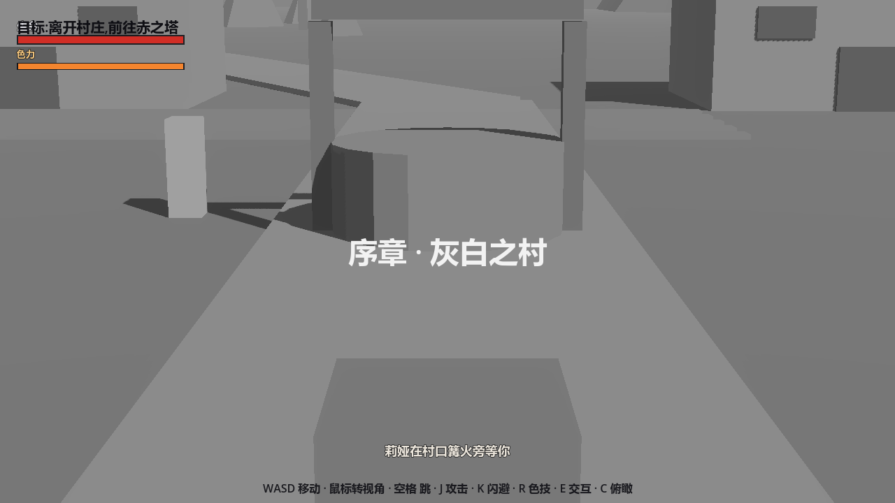
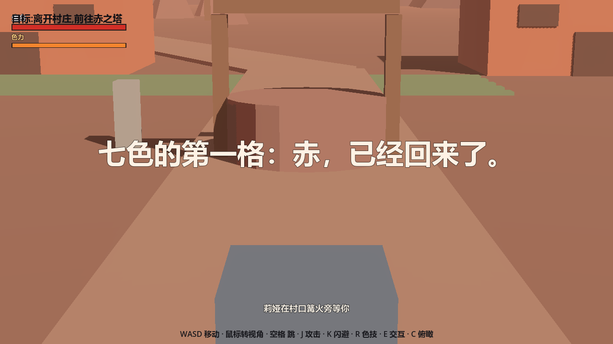

# 七色 · 游戏设计 v1

> 类型：3D 二次元动作冒险（ARPG）
> 视角：第三人称
> 世界：宽线性大世界（一个色轮大陆，七个色域，可回访）
> 首版目标：45–60 分钟竖切片（序章村 + 赤之领域）
> 制作方式：Blender 搭场景与逻辑 → BlenderGameKit 导出 → Godot 4.7.2 运行

---

## 0. 一句话

一个被夺走「看见颜色」能力的王子，在只剩黑白的世界里，一色一色地把世界打回来——每找回一色，世界多一片颜色，他多一种能力，也多知道一点真相。

### 三条支柱

1. **颜色即玩法**：七色不是收集品，是七种能力、七片色域、七套解谜规则、七场 BOSS。
2. **颜色即叙事**：世界从黑白变回彩色的过程，就是主角找回记忆与感情的过程。
3. **颜色即战斗**：敌人有「色核」，打碎色核敌人就褪色变弱；BOSS 战是夺色与还色的机制战。

### 情绪曲线

灰白（失去）→ 一点点暖色（希望）→ 一个色域恢复（热血）→ 发现真相（动摇）→ 七色齐（抉择）。

---

## 1. 世界观

### 1.1 起因（原案留白已补）

世界本无色。初代白之王从「光」中分出七色，封进七座色之塔；七色不是装饰，而是世界运转的七条规则。

主角 **艾尔文**，20 岁，白之王国的王子，天生「七色之瞳」——唯一能看见、调动七色的人。

加冕前夜，叔父 **摄政王 奥德里克** 发动政变：用「无色之刃」剜去他的七色之瞳，把他扔进世界边缘的「褪色之渊」。他的爱人、蓝之国的公主 **希尔维** 被囚于王城地下的「无色之间」。

艾尔文坠落，被边境村庄的少女 **莉娅** 救起。他失去颜色，也失去大半记忆，只记得「要回去」和「希尔维」这个名字。

村庄正在褪色。莉娅的红发带是他唯一还能看见的颜色。那不是残留的视力，而是七色之瞳的最后一次回响：**颜色没有被销毁，只是被「借走」了**。只要关掉七座「褪色装置」，颜色就会回来。

### 1.2 最后发现什么（原案「？？」已补）

七色不是被偷走的。先王——艾尔文的父亲——为了封印「无色之灾」，主动把七色从世界抽离，藏进儿子的瞳中。颜色离开世界太久，世界正在从边缘开始褪成白色。

奥德里克政变的真实目的不是篡位，而是**阻止封印彻底失效**。他的方案是：用七色加上希尔维（她是「无色之女」，天然能承载第八色）炼成新的封印，代价是牺牲一个人。

所以叔父不是纯恶：他要「用一个人的命换世界的命」。艾尔文要的是第三条路。

而魔族，是当年替人类背锅的「守色者」。被史书写成魔王的紫之王，其实是第八位守护者的残影——他知道真相，也在等一个愿意听的人。

### 1.3 势力

| 势力 | 位置 | 立场 |
|---|---|---|
| 白之王国 / 无色教团 | 中央王城 | 叔父的政权，口号「颜色是灾祸的根源」，麾下褪色骑士团 |
| 赤之国（炎铁帝国） | 色轮东侧 | 军事帝国，尚武，被抽色后陷入内乱 |
| 绿之国（巨树联邦） | 色轮南侧 | 森林城邦联合，重视记忆与血脉 |
| 蓝之国（镜海教国） | 色轮西侧 | 海之教国，掌握「真」的教义；希尔维的故乡 |
| 橙之商邦 | 赤与黄交界 | 沙漠自由城邦，谁给钱就帮谁 |
| 黄之遗国 | 赤与绿交界 | 已灭亡的古国，只剩遗迹与学者 |
| 青之风冠群岛 | 绿与蓝交界 | 自由港与浮空岛，海盗与风之民 |
| 紫之梦蚀之地 | 蓝与赤交界 | 魔族领地，梦与死的边界 |

### 1.4 结局（三个）

| 结局 | 条件 | 内容 |
|---|---|---|
| 归还七色（真结局） | 集齐七色 + 完成紫之盟约 | 世界恢复彩色，艾尔文失去七色之瞳，与希尔维作为普通人生活 |
| 成为第八色（代价结局） | 集齐七色，未完成紫之盟约 | 艾尔文接过「无色」成为新容器，世界保住颜色，但他与希尔维永隔 |
| 无色之灾（坏结局） | 最终战失败 / 封印彻底崩坏 | 世界归白，只剩主角瞳中的一点颜色 |

---

## 2. 七色与七领域

世界是一个**色轮大陆**：中央是无色王城，外环按彩虹顺序排列七片色域；三个国家各隔 120° 分布，四个衍生色域落在交界处。

```
                    赤（赤之国）
                橙          紫
            黄                  蓝（蓝之国）
                青          绿（绿之国）
                     （中环顺序）
  外环：赤 → 橙 → 黄 → 绿 → 青 → 蓝 → 紫 → 回到赤
  三国：赤（0°） / 绿（120°） / 蓝（240°）
```

色轮顺序不是随便排的：三国占据三个原色，衍生色域正好落在两国之间的交界带。这既是地理，也是政治——橙之商邦靠赤与黄的战争发财，紫之梦蚀之地是赤与蓝百年战争的旧战场。

### 2.1 七色总表

| 色 | 色域 | 政治归属 | 主题 | 获得的能力 | 色技 | 解谜规则 | BOSS |
|---|---|---|---|---|---|---|---|
| 赤 | 赤之边境 / 军镇 / 赤之塔 | 赤之国 | 勇气 | 燃 | 烈焰突进 | 点燃、熔炉、烧断锁链 | 赤之骑士团长 |
| 橙 | 沙脐商邦 | 赤黄交界自由城邦 | 欲望与交换 | 矢 | 箭雨、等价交换 | 天平、以物易物、沙漏 | 沙商会长 |
| 黄 | 辉光遗国 | 赤绿交界的灭亡古国 | 知识与光 | 照 | 闪光、显形 | 光路、镜面、照亮隐形文字 | 盲眼祭司 |
| 绿 | 巨树森林 | 绿之国 | 生命与记忆 | 生 | 藤蔓束缚、回春 | 藤蔓生长、记忆回放、二段跳 | 腐朽树王 |
| 青 | 风冠群岛 | 绿蓝交界自由港 | 自由与风 | 风 | 滑翔、空中冲刺 | 风向、浮空、上升气流 | 风暴之眼 |
| 蓝 | 镜海水都 | 蓝之国 | 静与真 | 镜 | 时缓、水镜反弹 | 水面行走、折射、时间缓 | 深海祭司 |
| 紫 | 梦蚀之地 | 魔族 | 梦与死 | 梦 | 真视、灵魂形态 | 梦境层、穿墙、看见死者 | 守墓人（可结盟，非必战） |
| 白 | 无色王城 | 白之王国 | 容器与代价 | — | — | 最终机制战 | 奥德里克 |

> 色彩关系（写进设定集，玩家可推理）：
> 黄 = 赤 + 绿，青 = 绿 + 蓝，紫 = 蓝 + 赤，橙 = 赤 + 黄。
> 每得到一个衍生色，说明玩家已经拿过它的两个组成色——所以衍生色域天然是「后期区域」，也是「回访旧区域」的理由。

### 2.2 推荐主线顺序

赤 → 绿 → 蓝（三国）→ 黄（赤+绿）→ 青（绿+蓝）→ 紫（蓝+赤）→ 橙（赤+黄）→ 白（王城）

- 三国先走，符合原案「前往红 / 绿 / 蓝三国获取能力提升」。
- 四个衍生色域在后，作为「能力组合」的验证场。
- 橙放在最后：它是终局前的锻造与交易枢纽，玩家用一路收集的材料换最终装备。
- 允许少量跳序：赤必第一，其余三国可自由排序；衍生色域按组成色解锁。竖切片只做赤。

### 2.3 「大世界」怎么落地

**不是无缝开放世界，是宽线性大世界。** 每个色域是一张 200–400 米的大场景，远景能看到相邻色域的地标（比如站在赤之边境能看到绿之国的巨树轮廓）。区域之间用「色门」连接——颜色恢复后门才会打开。

理由：BlenderGameKit 是「一个 Blender 场景 = 一关 = 一张 .tscn」，真正的无缝流式加载需要额外的世界分区工程。宽线性可以在现有工具内做出大世界的尺度感，同时把每一关的完成度做高。

**已拍板：竖切片先把赤之领域做成一张约 300 米见方的大地图**，村庄 / 边境 / 军镇 / 赤塔四个区域放在同一张场景里，玩家一路走过去，不切场景。这样能先验证「大世界感」够不够，再决定后面六个色域怎么铺。

---

## 3. 角色

### 3.1 艾尔文（主角）

- 20 岁，白之国王子。外冷内热，习惯先观察再动手。
- 外观：银白发、灰瞳；**每恢复一色，瞳色、发梢、外套纹样多一色**——这是给玩家最直观的成长反馈，也是最好的美术卖点。
- 战斗：单手剑 + 色力。基础三连、冲刺、闪避（无敌帧）、重击、处决（打碎色核）。
- 记忆：开始时只记得「希尔维」和「回去」；每恢复一色，找回一段记忆（由「色之回响」演出）。

### 3.2 希尔维（爱人）

- 18 岁，蓝之国公主，艾尔文的童年挚友。少年时两家和亲，她在白之王城住过三年。
- 被囚于「无色之间」。她是「无色之女」，天然能承载第八色，是整个计划的关键。
- 玩家在「色之回响」里看到她的记忆碎片，逐步拼出真相。

### 3.3 莉娅（村女 / 引路人）

- 16 岁，边境村庄的少女，救了艾尔文。
- **不是恋人。** 她是引路人、记录者、据点主人：村庄后期成为存档 / 商店 / 情报据点；她用「色鸟」给玩家送信，在检查点出现。
- 红发带是全村唯一还带颜色的东西，也是艾尔文看见的第一抹颜色。

### 3.4 奥德里克（最终 BOSS）

- 50 岁，摄政王，艾尔文的叔父。曾经也是守色者。
- 妻子死于第一次「无色之灾」，从此认定「感情是颜色的漏洞」。
- 三阶段 BOSS：人形剑术 → 无色领域（夺走场地颜色）→ 第八色融合（希尔维作为核心）。
- 不是纯恶：他有自己的道理，且会在最终战里说出真相。

### 3.5 紫之王 / 守墓人

- 第八位守护者的残影，被人类史书写成魔王。
- 知道「无色之灾」的真相，也在等一个愿意听的人。
- 玩家在紫之领域可以选择信任或讨伐；信任线解锁真结局。

### 3.6 六位色域 BOSS

共同点：都是**被颜色扭曲的人或兽**，不是天生的恶。打倒他们之后，颜色回归，他们多半也会恢复片刻清醒——这是每个色域的收尾情绪。

---

## 4. 玩法系统

### 4.1 核心循环

```
探索色域 → 发现褪色装置 → 战斗 / 解谜关闭装置 → 颜色回归演出
   ↑                                          ↓
   └──── 旧区域出现新路径 ←── 获得该色能力 ────┘
```

### 4.2 战斗

| 模块 | 内容 |
|---|---|
| 基础动作 | 移动、冲刺、闪避（无敌帧）、轻击三连、重击、受击、处决 |
| 色力槽 | 战斗资源。每恢复一色 +1 格上限（初始 2 格，满 7 格）；色技消耗 1–2 格 |
| 色技 | 每色一个主动技（见七色表），战斗中切换，UI 显示当前色 |
| 色核 | 敌人身上的发光核心。打碎后敌人褪色（变灰）、攻速与攻击力下降；这是「打碎颜色」的视觉与机制统一 |
| 敌人 | 无色兽（野兽，扑咬）、褪色骑士（剑 / 盾 / 枪）、色之守卫（精英）、BOSS |
| 失败 | 回到最近检查点，保留已恢复颜色与拾取物；不重载整关，不惩罚练习 |
| 手感 | 命中：闪红 + 相机轻震 + 音效；闪避：残影 + 时缓 0.2 秒；处决：短暂特写机位 |

### 4.3 色彩解谜（每域一条规则）

- **赤**：点燃。火盆、熔炉、烧断锁链；灰白世界里唯一能主动制造的暖色。
- **橙**：交换。天平、以物易物、沙漏；把重量 / 时间 / 物品换到另一边。
- **黄**：光路。镜面反射、照亮隐形文字、让「看不见的桥」显形。
- **绿**：生长。藤蔓搭桥、记忆回放（触碰物体看到过去）、二段跳。
- **青**：风。风向、浮空、滑翔、上升气流。
- **蓝**：静。水面行走、时间缓、折射光线解谜。
- **紫**：梦。梦境层叠、真视、灵魂形态穿墙。

规则只在对应色域生效，避免设计爆炸。得到能力后回到旧色域，用新能力打开隐藏路径——这是回访的理由。

### 4.4 色之回响（叙事与解谜的核心工具）

触碰重要物件（莉娅的红发带、希尔维的项链、战场的断剑、古国的碑文）时，全屏短暂恢复那件东西所属的颜色 2–3 秒，同时出现过去的影像与文字。

- 叙事：不用大段对话，用「看见过去」讲故事。
- 解谜：回响里看到的路径 / 密码 / 机关顺序，就是解谜答案。
- 技术上：环境饱和度 0 → 1 → 0 的渐变 + 屏幕闪白 / 滤镜，全部用现有节点可做。

### 4.5 探索与成长

| 系统 | 内容 |
|---|---|
| 检查点 | 篝火 / 色鸟。存档 + 回血 + 莉娅留言 |
| 快速旅行 | 已恢复的色域之间通过色门传送 |
| 收集 | 色之碎片（提升色力上限）、记忆碎片（解锁希尔维的过去）、宝箱（武器 / 防具） |
| 成长 | 每色 1 能力 + 1 色技；武器强化用橙之商邦的交换系统；血量 / 色力靠色之碎片 |
| 支线 | 每色域 1–2 条，围绕「颜色回来之后，人怎么面对过去」 |

### 4.6 难度与时长

- 竖切片 45–60 分钟；完整版 8–12 小时（七色域各 60–90 分钟 + 王城终章）。
- 难度两档：普通 / 故事（故事档敌人伤害减半，解谜提示更明显）。
- BOSS 三阶段，检查点密集，失败成本低。

---

## 5. 竖切片：赤之领域（45–60 分钟）

### 5.1 章节表

> 以下四个区域在 M1 里是**同一张大地图里的四块区域**（一张 Blender 场景、一张 .tscn），不是四个关卡。玩家一路走过去，中间用篝火存档。

| 章节 | 地图区域 | 时长 | 玩家动词 | 教学 | 检查点 | 情绪目标 |
|---|---|---|---|---|---|---|
| 0 灰白之村 | 村庄（地图东南） | 10–12 分 | 走、看、对话、拾取、第一场战斗 | 移动 / 视角 / 交互 / 闪避 | 村口篝火 | 困惑与不安 |
| 1 赤之边境 | 荒野（村庄北侧） | 10–12 分 | 潜行或战斗、找路、点火盆 | 色力 / 色技 / 敌人色核 | 边境篝火 | 紧张与好奇 |
| 2 赤之军镇 | 军镇（地图中央） | 12–15 分 | 对话、支线、熔炉解谜、Boss 门前 | 武器强化 / 支线 / 机关 | 军镇入口 | 人间烟火 |
| 3 赤之塔 | 塔楼（地图西北，三层） | 15–20 分 | 攀爬、机关、精英战、BOSS 三阶段 | 综合 | 塔前 / 塔顶 | 热血与决战 |
| 4 赤色回归 | 塔顶 | 4–5 分 | 观看、取回赤色 | 颜色恢复演出 | — | 释放与希望 |

### 5.2 「赤色回归」演出（全片最重要的 3 分钟）

1. 骑士团长倒下，褪色装置停转。
2. 全屏白闪，声音先回来（BGM 从无到有）。
3. 饱和度从 0 缓动到 1，赤色从塔顶向地平线扩散。
4. 天空、岩层、军镇的旗帜、村民的衣服依次有颜色。
5. 艾尔文的瞳孔从灰变赤，外套上出现第一道红色纹样。
6. 莉娅的色鸟落在塔顶，带来一句话：「你看见了吗？」
7. 标题动画：七色圆环的第一格亮起。

### 5.3 内容预算（防止「走路灌水」）

| 内容单元 | 数量 | 估算 |
|---|---|---|
| 可探索区域 | 4 块区域（同一张大地图） | 约 30 分钟纯探索 |
| 战斗遭遇 | 8–10 场 | 约 12 分钟 |
| 解谜 | 3 个（点火盆 / 熔炉 / 塔机关） | 约 8 分钟 |
| 剧情对话 / 演出 | 6 段 | 约 8 分钟 |
| BOSS | 1 场三阶段 | 约 5 分钟 |

合计约 55–65 分钟，符合竖切片目标。

### 5.4 竖切片必须跑通的系统

移动 / 相机 / 战斗 / 色力 / 敌人 AI / BOSS 三阶段 / 交互 / 对话 / 存档 / 检查点 / HUD / 主菜单 / 暂停 / 颜色恢复演出 / BGM 与音效。

**不在竖切片里**：另外六色域、无缝开放世界、装备词条、复杂支线网、多结局。

---

## 6. 技术落地方案

### 6.1 工程结构

```
games/七色/
├── 七色.blend                 ← 1 个 Blender 场景（赤之领域大地图）+ 全部逻辑图 + 文本块脚本
└── 七色_godot/                ← 插件自动生成，可直接 F5
    ├── scenes/ 赤之领域.tscn
    ├── scripts/              节点图生成的 GDScript
    ├── scripts/custom/       自定义 GDScript（战斗 / 敌人 / 对话 / 颜色演出）
    ├── art/ materials/ audio/ shaders/ curves/
    └── project.godot

scripts/make_shichise.py       ← 生成脚本（唯一真相，改它，不要手改 .blend）
scripts/check_shichise.py      ← 离线门禁（断言场景 / 图 / 存档 / 颜色状态）
scripts/play_shichise.py       ← 真窗口自动试玩 + 截图（验收因果可读）
```

### 6.2 逻辑图分工

| 图 | 挂在哪 | 只放什么 |
|---|---|---|
| 角色图（公共） | 玩家物体 | 输入 / 移动 / 冲刺 / 闪避 / 三连击 / 色技 / 交互 / 相机 / 动画状态机 |
| 关卡图（每关一张） | 场景根 | 触发区 / HUD / 对话 / 检查点 / BGM / 失败处理 / 切关 |
| AI 图 | 敌人 | 巡逻 / 发现 / 追击 / 攻击 / 色核破碎 / 死亡 |
| 界面设计图 | 主界面 autoload | 主菜单 / 暂停 / HUD / 对话框 / 血条 / 色力条 |
| 游戏动画图 | 角色与敌人 | 待机 / 走 / 跑 / 攻击 / 闪避 / 受击 / 死亡 / BOSS 阶段 |
| 游戏环境与后期图 | 每关 | 灰白 / 赤色两套环境预设 |

### 6.3 每个系统怎么落到节点

| 系统 | 现有能力 | 落地方式 |
|---|---|---|
| 移动与相机 | 已有 | 第三人称预设 + 弹簧臂 + 鼠标视角 |
| 战斗血量 | 插件不内置 | 用『变量_设置 / 增减』做 HP 与色力，『界面_进度条』做血条 |
| 攻击判定 | 已有射线 / 区域 | 近战用玩家前方 Area3D（攻击时开启）；远程用『射线_检测』 |
| 受击反馈 | 已有 | 『特效_闪红』『相机_震动』『屏幕_滤镜』『音效_播放』 |
| 敌人 AI | 已有 | 『AI_状态』『AI_转场』『AI_看得见』『AI_攻击』+ 寻路 |
| BOSS 三阶段 | 已有 | 变量记阶段 + AI 转场条件 + 动画状态机 |
| 交互 | 已有 | 『进入区域』+『输入_按键』E +『界面_文本』提示 |
| 对话 | 已有 | 『界面_对话框』『对话_选择』 |
| 存档 / 检查点 | 已有 | 『存档_写入 / 保存 / 载入 / 读取到变量』，按槽位存颜色与进度 |
| 颜色状态 | 已有环境系统 | 每关一份环境预设：灰白（饱和度 0）/ 已恢复（饱和度 1）；进关按存档应用 |
| 颜色恢复演出 | 已有 | 环境预设 +『定时_缓动属性』推饱和度 +『屏幕_闪白』+ 相机切换 |
| 色之回响 | 已有 | 同上，短时饱和度脉冲 + 屏幕滤镜 + 回忆影像 |
| UI | 已有 | 界面设计图 +『界面_主界面』+ Esc 暂停 |
| 演出运镜 | 已有 | 『相机_切换 / 路径』『定时_时间轴』『屏幕_渐变遮罩』 |
| BGM / 音效 | 已有 | 『音乐_场景 BGM』『音效_播放』 |

### 6.3.1 自定义脚本（本项目的关键杠杆）

插件第一百五十一轮起支持 **Blender 文本块 → GDScript**：在文本编辑器里写脚本，节点用『脚本_加载 / 停止 / 调用』挂到宿主上，导出时自动落到 `res://scripts/custom/`。

竖切片里凡是「节点图拼起来会很别扭」的系统，都走这条路：

| 用自定义脚本做 | 为什么不用纯节点图 |
|---|---|
| 战斗控制器（三连击 / 闪避无敌帧 / 命中判定 / 色核） | 需要按帧状态机与 `get_overlapping_bodies()` 遍历，节点图会爆 |
| 敌人受伤与死亡接口 | 需要统一 `take_hit()` 协议，方便所有敌人复用 |
| 锁定视角 / BOSS 战镜头 | 需要每帧算目标点，节点图没有「找最近敌人」节点 |
| 对话 JSON 阅读器 | 100+ 句台词，一节点一句会把图挤爆；JSON 也方便你改台词 |
| 颜色恢复波 / 色之回响 | 需要 Tween 与环境资源联动，脚本更直接 |
| 存档迁移与版本号 | 存档字段会随章节增加，脚本里做兼容更稳 |

原则：**流程、触发、演出编排用节点图；逐帧系统与数据驱动的内容用自定义脚本。** 两者通过『脚本_调用』和信号接口衔接。

### 6.4 已知缺口（动手前先认清）

| # | 缺口 | 影响 | 应对 |
|---|---|---|---|
| 1 | 插件不带血量 / 伤害系统 | 战斗要自己拼 | 做成一个可复用的战斗脚本 + 节点图外壳：HP、色力、攻击、受击、死亡、色核 |
| 2 | 对话框图每句一个节点 | 竖切片约 100 句，图会很挤 | 用自定义脚本写对话 JSON 阅读器；台词数据与图分离 |
| 3 | 选项没有条件引脚 | 「没钥匙时选项灰着」做不出来 | 对话 JSON 阅读器里自带条件字段，按变量过滤选项 |
| 4 | 全局饱和度是整屏的 | 单个物件无法保持颜色 | 用「色之回响」整屏短暂回色绕开；不做单物件免疫 |
| 5 | 射线方向是静态属性 | 近战不能用射线 | 近战在自定义战斗脚本里用朝前的 Area3D / 距离 + 角度判定，不走射线 |
| 6 | 没有无缝世界流式 | 做不了真开放世界 | 宽线性 + 色门 + 关卡切换；单关做大、远景放地标 |

### 6.5 验收标准

**M1 灰盒竖切片（我做）**

- 离线探针全绿：场景存在、逻辑图连线完整、存档字段正确、颜色状态正确。
- 真 Godot 无头探针：从村庄走到塔顶，战斗命中、色核破碎、BOSS 阶段切换、颜色恢复。
- 真窗口自动试玩：每章至少一张截图；黑白 → 赤色的前后对比可读；战斗命中玩家看得出因果。
- 20–30 分钟可通关（灰盒），无 blocker。

**M2 美术替换（你做）**

- 主角 / 敌人 / 村庄 / 赤境 / 军镇 / 赤塔替换为正式模型。
- 卡通材质、描边、三阶明暗在 Godot 里与 Blender 预览一致。
- 颜色恢复前后各截一组图，确认「灰白 → 赤色」的冲击力。

**M3 打磨**

- 45–60 分钟通关；3 个检查点；1 场 BOSS；无卡关点。
- 音量、字幕、按键提示、暂停、存档全部可用。
- 打包出 exe。

---

## 7. 美术资产清单（你负责）

### P0 竖切片必需

| 类别 | 清单 | 规格建议 |
|---|---|---|
| 主角 | 艾尔文：待机 / 走 / 跑 / 三连击 / 闪避 / 受击 / 死亡 / 色技 / 处决 | 8k–15k 三角面，骨骼 ≤ 60，卡通材质，7 处可换色的发光装饰 |
| NPC | 莉娅（待机 / 对话 / 招手 / 色鸟）、军镇铁匠、村民 3 个 | 4k–8k 面 |
| 敌人 | 无色兽（狼形）、褪色骑士（剑 / 盾 / 枪三变体）、色之守卫（精英） | 6k–12k 面，色核单独一个可破坏网格 |
| BOSS | 赤之骑士团长（三阶段形态，可共用模型 + 换材质 / 加部件） | 15k–25k 面 |
| 村庄 | 民房 6–8 栋、教堂、田地、水井、栅栏、村口牌坊（模块化） | 单件 200–800 面，可复用 |
| 赤之边境 | 红岩柱、灰白枯树、军旗、营地帐篷、断桥、远山 | 模块化 |
| 赤之军镇 | 街道、铁匠铺、旅馆、城门、熔炉、火盆、告示牌 | 模块化 |
| 赤之塔 | 三层塔体、螺旋楼梯、机关门、火焰喷口、塔顶平台 | 模块化 |
| 道具 | 篝火、宝箱、钥匙、红发带、项链、断剑、碑文、色之碎片 | 低面数，可发光 |
| UI | 七色圆环图标、血条底、色力条底、对话框框体、按键提示图 | 2D 图片，512–1024 |
| 环境 | 灰白天空盒、赤色天空盒、远景剪影、雾与云 | 天空着色器已内置，可先出概念图 |

### P1 后续色域

橙之沙市、黄之遗国、绿之巨树、青之风岛、蓝之水都、紫之墓园；每种色域一套模块化建筑 + 一套敌人变体。

### 美术约定

- 全二次元 NPR：三阶明暗 + 描边 + 面部 SDF；材质命名 `MAT_<色域>_<物件>`。
- 主角模型必须留出「可换色」材质槽：瞳孔、发梢、外套纹样、剑刃、披风内衬、护腕、靴扣。
- 所有场景按 200–400 米尺度设计，远景放相邻色域地标。

---

## 8. 里程碑

| 阶段 | 产出 | 负责人 |
|---|---|---|
| M0 设计定稿 | 本文件 | 我 + 你审 |
| M1 灰盒竖切片 | 一张大地图、全部系统、探针与自动试玩 | 我 |
| M2 美术替换 | 模型 / 场景 / 材质 / 动画 | 你 |
| M3 演出与音频 | 运镜 / BGM / 音效 / UI 定稿 | 我 + 你 |
| M4 验收与打包 | 门禁全绿 + exe | 我 |

---

## 9. 与原案的对照（留白补完表）

| 原案 | 原状态 | 本版补完 |
|---|---|---|
| 起因 | 待补充 | 叔父政变、无色之刃、褪色之渊、被村女所救、红发带的第一抹颜色 |
| 过程 | 某地苏醒、失去能力、离开村子 | 五章竖切片：村庄教学 → 边境潜行 → 军镇解谜 → 赤塔 BOSS → 赤色回归 |
| 「爱上了主角」 | 担心太随意 | 莉娅改为引路人 / 据点主人，不谈恋爱线；爱人线留给希尔维 |
| 七色 | 红绿蓝 + 衍生色（暂定 7） | 彩虹七色，三国占三原色，四衍生色域落在交界；色彩关系可推理 |
| 最后 | 集齐七色打开时空传送 | 七色齐 → 时空门 → 无色之间 → 发现「无色」是第八色 / 容器 |
| 反派 | 各国反动派 + 魔物 + 魔族 | 表层反派是褪色骑士团；真正反派是叔父；魔族是背锅的守色者 |
| 最终 BOSS | 挟持爱人的本国皇室 | 摄政王奥德里克，三阶段，希尔维作为核心 |
| 目标 | 寻回七色，拯救爱人 | 保留，并增加「世界正在褪成白色」的倒计时压力 |

---

## 10. 已拍板

| 项 | 定案 |
|---|---|
| 世界形式 | 先把赤之领域做成**一张约 300 米见方的大地图**（村庄 / 边境 / 军镇 / 赤塔同图），验证「大世界感」后再决定后续六域怎么铺 |
| 美术参考 | **原神式明亮卡通**：明亮饱和、天空通透、角色高光干净；颜色恢复时的对比最强 |
| 战斗镜头 | **自由第三人称 + 软锁定**：平时自由转视角，靠近敌人轻微吸附，BOSS 战切专用机位 |
| 竖切片结尾 | **停在赤色回归**：骑士团长倒下 → 全屏白闪 → 饱和度 0→1 → 七色圆环第一格亮起 → 莉娅的色鸟传信 |
| 主角名 | 暂用 **艾尔文**，后续可改（改名只影响文本与常量，不影响资产） |

---

## 11. M1 灰盒：已跑通（2026-11-06）

### 先说结论

一张 300×300 米的赤之领域大地图已经能在 Godot 里从村口一路走到塔顶：对话拿火把 → 点三座火盆 → 塔门升起 → 打十个小怪 → 上塔顶触发赤之骑士团长 → 三阶段 BOSS → 击杀 → **灰白世界在 4 秒内恢复成赤色**。自检 33/33 通过。





### 已经实现

| 系统 | 内容 |
|---|---|
| 大地图 | 村庄（8 屋 + 教堂 + 水井 + 田地）/ 赤之边境（岩柱 + 枯树 + 营地 + 火盆）/ 军镇（城门 + 主街 + 铁匠铺 + 旅馆）/ 赤之塔（四层 + 四段斜坡 + 塔顶核心）；同一张 Blender 场景 |
| 角色 | 第三人称：WASD + 鼠标视角 + 空格跳 + C 俯瞰 / V 侧视（BlenderGameKit 预设） |
| 战斗 | J 三连击（12 / 14 / 22）、K 闪避（0.4 秒无敌帧）、R 色技（赤色回归后解锁）、软锁定（镜头前 8 米 60°） |
| 敌人 | 10 个小怪（边境 3 / 军镇 3 / 塔 4）+ 赤之骑士团长 BOSS；半血色核碎裂 → 褪色变弱；BOSS 三阶段 |
| 解谜 | 莉娅对话拿火把 → 三座火盆 → 塔门升起（AnimatableBody3D 真的抬起来） |
| 检查点 | 4 个篝火；靠近自动存档 + 回血；死亡 2.6 秒后回最近篝火 |
| 对话 | 莉娅 4 句开场 + 后续短句；E 推进；选项系统还没接 |
| 存档 | `user://gk_shichise.json`：红 / 火把 / 火盆 / BOSS / 检查点位置 |
| 颜色 | 环境饱和度 0（灰白）→ BOSS 死后 4 秒推到 1.5（赤色回归）；色之回响 1.35 闪回 |
| HUD | 生命 / 色力 / BOSS 条 / 交互提示 / 过场字 / 黑屏死亡提示 |
| 自检 | `scripts/check_shichise.py`：23 项静态 + 10 项真 Godot 无头断言 |

### 怎么跑

```powershell
# 1) 重新生成（改 .blend / 节点图 / 场景后跑这一条）
& "D:\blender-4.5.5-windows-x64\blender.exe" -b --gpu-backend vulkan --python scripts\make_shichise.py

# 2) 用 Godot 打开工程，按 F5
& "D:\godot\Godot_v4.7.2-stable_win64.exe" --path games\七色\七色_godot

# 3) 自检（静态 + 真 Godot 无头跑完整链路；会清空开发存档）
python scripts\check_shichise.py
```

**按键**：WASD 移动 / 鼠标转视角 / 空格 跳 / **J 攻击** / **K 闪避** / **R 色技** / **E 交互** / C 俯瞰 / V 侧视。

**重置存档**：删掉 `%APPDATA%\Godot\app_userdata\七色\gk_shichise.json`（或 Godot 里的 `user://gk_shichise.json`）。

> ⚠ **M2 开始后不要再跑 `make_shichise.py`。** 它是 M1 灰盒的**一次性脚手架**：
> 开头 `clear_all()` 会清空对象 / 材质 / 节点图，再从代码重建。你一旦在 `.blend`
> 里替换模型、摆场景、改节点图，重跑它会把你的改动**全部覆盖**。
> 之后请用 Blender 侧栏的『导出到 Godot』（或插件菜单）导出。
>
> 需要保留的**物体名**（世界脚本按名字找它们，改名会找不到）：
> `艾尔文` / `敌人_边境1..3` / `敌人_军镇1..3` / `敌人_塔1..4` /
> `赤之骑士团长` / `赤塔门` / `火盆1..3` / `篝火_村庄` / `篝火_边境` /
> `篝火_军镇` / `篝火_赤塔` / `莉娅`。替换模型可以，改名不行。
> 敌人的物理类型保持 `CharacterBody3D`，塔门保持 `AnimatableBody3D`。

### M1 的已知限制（M2 再处理）

- 全部是方块占位；没有正式模型 / 材质 / 动画。
- 没有音频（BGM / 音效）、没有主菜单 / 暂停 / 设置。
- BOSS 只有近战；没有第二阶段的地面 AOE / 夺色机制。
- 对话面板是脚本自绘的；还没有接『界面_对话框』和选项分支。
- 一个存档槽；没有「新游戏 / 继续游戏」按钮。
- 没有装备 / 技能树 / 色之碎片成长。
- 没有第一人称、没有锁定键（软锁定是自动的）。

### 下一步

1. **M2 美术替换**（你）：主角 / 莉娅 / 敌人 / BOSS / 四块区域的模型与材质；按 `游戏设计.md` 第 7 节的清单来。
2. **M3 演出与音频**（我 + 你）：运镜、BGM、打击音效、UI 皮肤、对话选项。
3. 绿之国：照赤之领域的结构复制一张新地图，加上「绿」能力（藤蔓 / 治疗 / 二段跳）。

> 下一步（M1）已经完成；现在可以开始 M2 的美术替换了。
